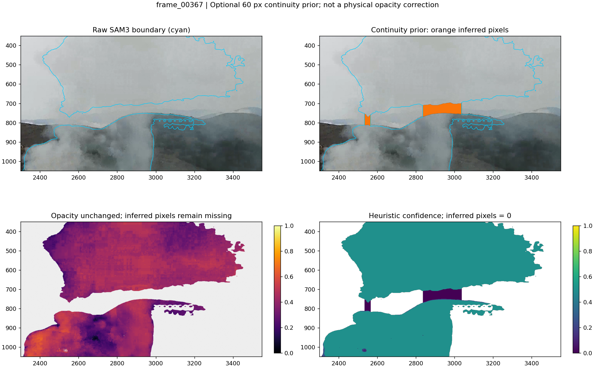
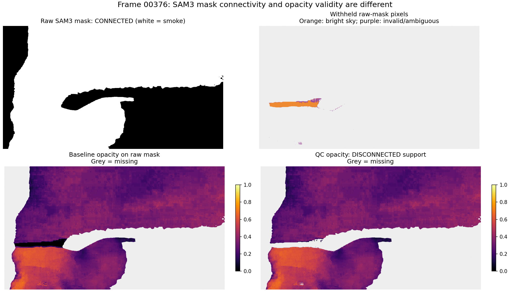

# Extreme terrain–sky failure modes

The author identifies a continuous plume across the terrain/sky background, but equal-looking smoke and sky can be poorly constrained by RGB appearance. The upper plume is not rejected as cloud solely because a lower-positive prompt ablation omits it.

Frame367 illustrates missing mask support and the inadequate width of a narrow continuity patch. A broader corridor constrained by upper/lower support, area limits and temporal context is proposed for future evaluation. The current patch is not adopted as a validated mask.

Frame376 has a connected raw SAM3 mask. Its supported-opacity field becomes disconnected under the present attenuation/regime QC rules, which withhold sky brightening and near-neutral contrast. This is a separate retrieval/QC limitation, not removal of SAM3 segmentation. The baseline already contains near-zero opacity along part of the strip. Background error, regime assumptions and threshold conservatism remain possible contributors; the stage attribution is not proof of physical invalidity.

All inferred segmentation pixels remain explicitly separate and have missing opacity. Existing baseline values on raw-mask pixels may instead be shown as flagged provisional estimates using the optional boundary view. This does not make them valid, supply a source-radiance reference, or justify interpolation. Neither silhouette connectivity nor temporal smoothness establishes physical accuracy. This case is retained as a limitation; further numerical tuning has stopped at the author's direction.
